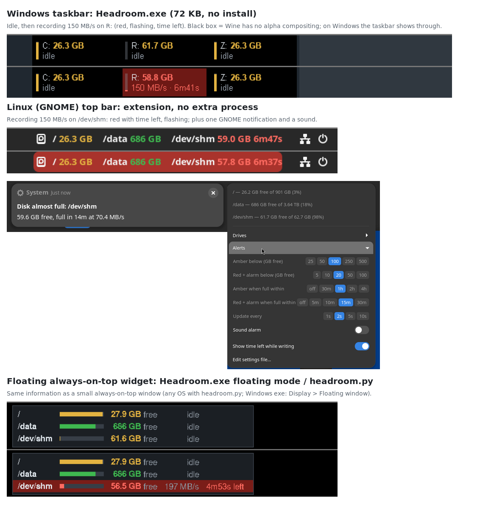

# Headroom

*How much recording space, and time, your disks have left.*

In audio, headroom is the margin you have before the signal clips. Here it is the
margin before a disk fills up. Headroom is an always-visible free-disk-space monitor
for data-acquisition PCs (video, ephys, behavior/state-machine rigs). For every drive
(or the ones you pick) it shows the **free space**, the **sustained write rate** and
the **time left until the disk is full**, and turns amber, then flashing red with a
sound, before a recording can run out of space.



## Which one do I use?

| Computer | Use | Where it shows |
|---|---|---|
| Windows 7 – 11 (64-bit) | **`Headroom.exe`** from [Releases](../../releases/latest) (72 KB, nothing to install) | On the taskbar next to the clock, or as a floating window |
| Linux with GNOME (e.g. Ubuntu) | **`gnome-extension/`** | In the top bar |
| Anything else (KDE/XFCE, macOS, Windows with Python) | **`headroom.py`** | Floating always-on-top window |

All three read and write the same `headroom.json` settings format.

## Made to stay out of the way of acquisition software

- **No file scanning.** A disk-space *analyzer* walks every file and hammers the disk.
  Headroom makes one `GetDiskFreeSpaceEx`/`statvfs` call per drive per interval,
  which reads the filesystem's in-memory free-space counter. It does no disk I/O.
- **Sleeps between updates.** One timer (default every 2 s), and it redraws only
  when a shown value changes. The red flashing timer only runs while something is red.
- **Lowest sensible priority.** On Windows that means below-normal priority plus EcoQoS
  "efficiency mode" and low memory priority. On Linux, `headroom.py` uses `SCHED_IDLE`.
- **Never freezes.** Network and USB drives are queried on a worker thread, so a dead
  share shows "no response" instead of hanging the display. On GNOME this means it
  can never stall your desktop.
- **Never steals focus.** Clicking or dragging the Windows readout doesn't take the
  keyboard from your acquisition software, and the menu hands it back.
- **Gets out of the way of full-screen stimulus displays.** On Windows, the readout
  hides while a full-screen app covers its monitor, the same way the taskbar does.
  You can turn this off.

Measured on this Ubuntu machine: `headroom.py` idles at 0.02–0.03 % of one CPU core
(10–16 ms of CPU time per minute) and about 30 MB of RAM, which is mostly the Python
interpreter. The Windows exe is plain C with no runtime: one thread that sleeps in the
Windows message loop between updates, plus a pooled worker only for network or USB
drives.

## Windows: `Headroom.exe`

1. Download `Headroom.exe` from the [latest release](../../releases/latest), put it
   anywhere (e.g. `C:\Tools\`) and double-click it. It appears on the taskbar, just
   left of the tray/clock area.
2. **Drag** it along the taskbar to move it. **Right-click** for the menu:
   - **Drives**: auto (all local drives) or pick drives; include network drives.
   - **Alerts**: thresholds and the sound alarm.
   - **Display**: on the taskbar or in a floating window; show rate/time left; hide over
     full-screen apps.
   - **Update every**, **Start at login** (per user, no admin needed), and
     **Edit settings file…**.
3. Settings are kept in `%APPDATA%\Headroom\headroom.json`. If a `headroom.json`
   sits **next to the exe**, that file is used instead. That lets you set up one copy
   and drop the same folder on every rig.

Command line options: `-drives "C:,D:"` (or `all`), `-mode taskbar|floating`,
`-config <file>`, `-reset-position`, `-version`.

Notes:
- If the taskbar is on the side of the screen (Windows 10), Headroom uses the floating
  window instead. With an auto-hiding taskbar, the readout hides along with it.
- The exe is unsigned, so Windows SmartScreen may ask the first time ("More info →
  Run anyway"). Some institutional antivirus tools may need an exception.
- Release downloads are built by GitHub Actions from the tagged source (see
  [Making a release](#making-a-release)).
- To build it yourself: `windows/build.sh` (Linux/macOS with `clang` + `lld-link`; it
  generates the Windows import libraries itself, so no Windows SDK is needed). The
  portable logic has unit tests: `cc -std=c11 -DHR_TEST windows/test_core.c -lm && ./a.out`.

## Linux with GNOME: top-bar extension

```bash
gnome-extension/install.sh
```

Then let GNOME notice the extension. On X11: press Alt+F2, type `r` and press Enter.
On Wayland: log out and back in. Then enable it:

```bash
gnome-extensions enable headroom@local
```

Click the readout to see details per drive (free / total / rate / full in), choose
**Drives**, and set **Alerts** with one click on the preset buttons. It runs inside
GNOME Shell, so there's no extra process. It **keeps running on the lock screen**, so
the alarm still sounds during a long recording; while locked, its menu is read-only.
It supports GNOME 45–49 and uses `~/.config/headroom/headroom.json`, the same file
as `headroom.py`.

## `headroom.py`: floating widget on any OS

```bash
python3 headroom.py                       # Linux / macOS (Ubuntu: sudo apt install python3-tk)
pythonw headroom.py                       # Windows, no console window
python3 headroom.py --drives / /data      # only these drives (or folders)
```

Drag it with the left mouse button and right-click for the same options as above.
**Start at login** writes `~/.config/autostart/headroom.desktop` on Linux or the
per-user Run key on Windows. It needs only the Python 3.8+ standard library.

## Uninstall

Nothing is installed system-wide and no admin rights are needed. Headroom leaves only
a settings folder and, if you turned on **Start at login**, a startup entry.

**Windows (`Headroom.exe`)**

1. Right-click the readout, untick **Start at login**, then choose **Exit**.
2. Delete `Headroom.exe`, plus the `headroom.json` next to it if you used one.
3. Delete the settings folder `%APPDATA%\Headroom`.

Or run these in a Command Prompt. They also work if the exe is already deleted, and any
that find nothing to remove just print a harmless error:

```bat
taskkill /im Headroom.exe
reg delete "HKCU\Software\Microsoft\Windows\CurrentVersion\Run" /v Headroom /f
rmdir /s /q "%APPDATA%\Headroom"
```

**Linux, GNOME extension**

```bash
gnome-extension/uninstall.sh            # off the top bar right away; keeps your settings
gnome-extension/uninstall.sh --purge    # also deletes ~/.config/headroom
```

If `install.sh` told you it switched GNOME user extensions on and you want them off
again, run `gsettings set org.gnome.shell disable-user-extensions true`.

**`headroom.py`**

Right-click it, untick **Start at login**, choose **Exit**, then delete `headroom.py`
and its leftovers:

```bash
rm -f ~/.config/autostart/headroom.desktop   # only exists if Start at login was on
rm -rf ~/.config/headroom                    # settings (shared with the GNOME extension)
rm -f /tmp/headroom-$(id -u)-*.lock          # small lock file (also cleared at reboot)
```

On Windows, `headroom.py` uses the same `%APPDATA%\Headroom` folder (plus a
`headroom.log`) and the same `Headroom` startup entry as the exe, so the Windows steps
above apply. On macOS, delete `~/Library/Application Support/Headroom`.

## How the alerts work

| Level | When (defaults) |
|---|---|
| Amber | free space < **100 GB**, or the disk will be full within **60 min** at the current rate |
| Red, flashing + sound | free space < **20 GB**, or full within **15 min** |

- The **time left** uses the *sustained* write rate over the last 30 s: the median of
  the trends of three 10-second slices. A recording's rate appears about 15–20 s after
  it starts. A one-off file copy (say, 10 GB in a few seconds) doesn't cause a false
  alarm.
- The level must persist for about 3 s before the sound starts. The sound repeats every
  30 s while any drive is red. On GNOME you also get one notification per episode.
- Tune the thresholds per rig. For example, two Neuropixels probes at about 50 MB/s use
  about 180 GB per hour, so "red below 20 GB" leaves about 7 minutes.
- "GB" means GiB (1024³), the same unit Windows Explorer shows.

## Settings reference (`headroom.json`)

| Key | Default | Meaning |
|---|---|---|
| `drives` | `[]` | `[]` = all local drives (auto); or e.g. `["C:", "D:"]`, `["/", "/data"]`, or folders |
| `include_network` | `false` | auto mode also shows network drives |
| `interval_s` | `2` | seconds between measurements |
| `warn_gb` / `crit_gb` | `100` / `20` | amber / red below this much free space |
| `warn_min` / `crit_min` | `60` / `15` | amber / red when the disk will be full within N minutes (`0` = off) |
| `rate_window_s` | `30` | write rate = sustained trend over this many seconds |
| `show_rate` | `true` | show rate / time left |
| `sound`, `alarm_repeat_s` | `true`, `30` | beep while red, every N seconds |
| `font_size`, `opacity`, `x`, `y` | `11`, `0.92`, `null` | floating window look and position |
| `mode` | `"taskbar"` | Windows exe: `"taskbar"` or `"floating"` |
| `taskbar_offset` | `null` | Windows exe: px from the taskbar's right end (`null` = next to the tray) |
| `hide_fullscreen` | `true` | Windows exe: hide while a full-screen app covers that monitor |

Edits to the file are picked up automatically, and invalid JSON is ignored, so the
previous settings stay in effect.

## Files

```
headroom.py                      floating widget, any OS (Python 3.8+, Tk)
gnome-extension/install.sh       installs the GNOME top-bar extension (uninstall.sh removes it)
gnome-extension/headroom@local/  extension.js, core.js (testable logic), metadata.json, stylesheet.css
windows/headroom.c               source of Headroom.exe (self-contained Win32 C, no C runtime)
windows/build.sh, test_core.c    build script and unit tests
.github/workflows/release.yml    builds Headroom.exe and publishes it on the Releases page
```

`Headroom.exe` itself is not in the repository; it is attached to each release.

## Making a release

Tag a version and push the tag:

```bash
git tag v1.1
git push origin v1.1
```

The [release workflow](.github/workflows/release.yml) runs the unit tests, builds
`Headroom.exe` from that exact commit and publishes it as a new release with the exe
attached. To build without releasing, use **Run workflow** on the Actions tab; the exe
is then available as a download on that workflow run.

## Testing status

- `headroom.py`: unit tests, plus GUI runs on Ubuntu 24.04 (X11), including a
  simulated 200 MB/s recording.
- GNOME extension: unit tests (gjs), plus a live run in a sandboxed GNOME Shell 46
  covering the top bar, alerts, notification, menu, settings and hot reload, and
  `install.sh` / `uninstall.sh` end to end.
- `Headroom.exe`: unit tests, plus runs under Wine 9 covering rendering, both modes,
  placement on a simulated Windows 11 taskbar, a simulated recording, menus, settings,
  start at login, single instance and the uninstall commands. **It hasn't been run on
  a physical Windows PC yet.** On the first rig, check that the readout sits next to
  the tray; drag it if needed.

## License

BSD 3-Clause. See [LICENSE](LICENSE).
